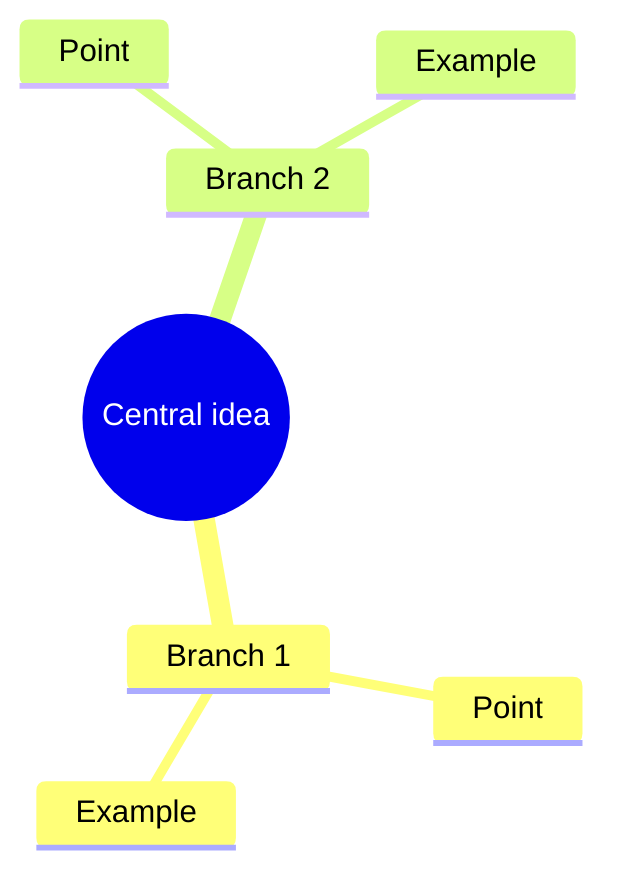

# Mind Map

Show how the parts of a topic connect.

## Steps

1. **Center.** State the central idea in one short phrase.
2. **Branches.** Pick 4 to 6 main branches. Each branch is one sub-idea.
3. **Leaves.** Under each branch, add 2 to 4 short points and exactly one concrete example.
4. **Links.** List up to 3 cross-links between branches ("A affects C because ...").
5. **Output.** Show the map as an indented outline. Also give a Mermaid `mindmap` block the user can render:

## Rules

- Short phrases, not sentences, in the map.
- Use the user's material when they shared some.
- After the map, ask one question that makes the user explain a cross-link in their own words.
